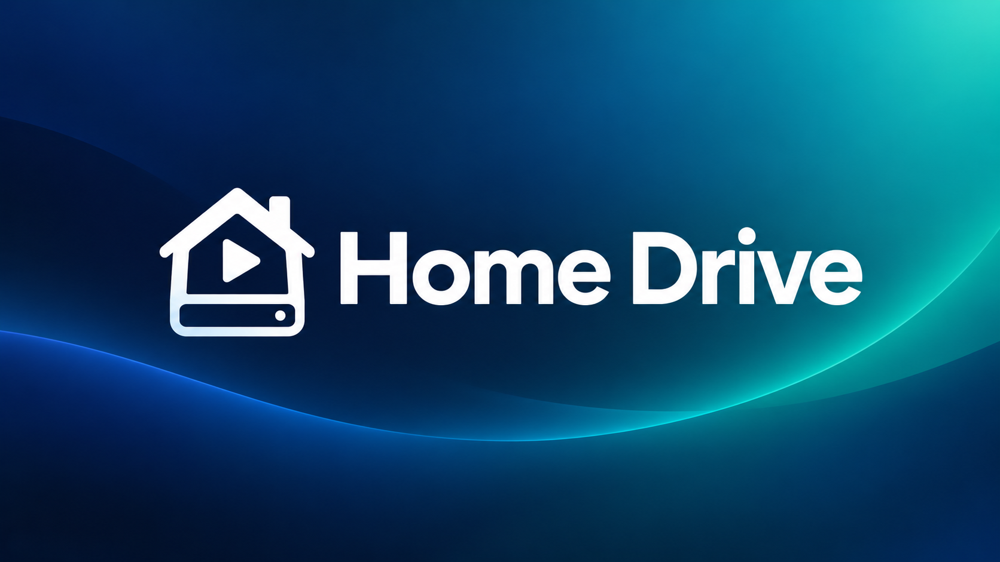

# Home Drive



Browse and play the router's USB drive (SMB share) on an Android TV box.

- Folders and files with sizes; **OK** opens or plays, **Back** goes up a folder.
- Plays video and music with ExoPlayer (Media3), streamed straight from SMB (smbj), including mkv and surround audio.
- **Resume:** remembers where you stopped in each video ("Resume at 1:02:13"). ⏮ starts over.
- **Captions and languages:** the **CC** button lists subtitles built into the file and subtitle files saved next to it (`Movie.srt`, `Movie.en.srt`, `Movie.Spanish.srt`; `.srt`, `.vtt`, `.ass`, `.ssa`). The gear menu switches audio language when a file has several. Your captions and audio choice carry over to the next video.
- **CONNECTION** (top right): server, share, username (empty for guest), password. Asked for on first launch.

## Build

Optionally pre-fill the connection screen for your own build with a `defaults.properties` file in the project root. It's ignored by git:

```properties
server=192.168.0.1
share=Media
username=me
```

The password is never built in. It's entered on the TV and stored in the app.

```bash
export JAVA_HOME=/opt/homebrew/opt/openjdk@17
export ANDROID_HOME=/opt/homebrew/share/android-commandlinetools
./gradlew assembleRelease
cp app/build/outputs/apk/release/app-release.apk dist/Home-Drive.apk
adb install -r dist/Home-Drive.apk
```
